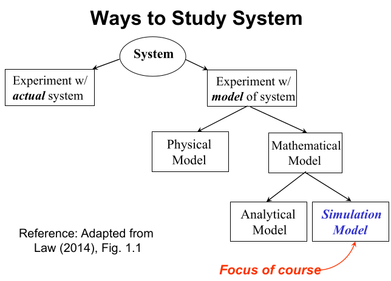
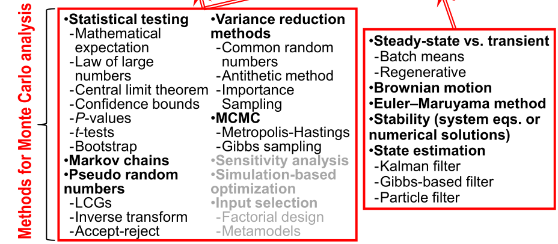

<!--  -->

Monte Carlo methods are algorithms that use random sampling to solve numerical problems. The name comes from the Monte Carlo Casino in Monaco, and the reference to gambling is apt: we answer a question by playing a game of chance many times and looking at how the games come out. What is surprising is that the question need not involve chance at all! An integral, or the number $\pi$, is a fixed quantity, and yet we can turn the problem of computing it into a probabilistic one and approximate the answer by simulation.

## What are Monte Carlo methods?

At their core, Monte Carlo methods rely on **repeated random sampling**. We generate a large number of random samples, compute something from each of them, and study the statistics of what we get. Because the samples are random, so is our answer. But the same probability theory that makes the answer random also tells us how far from the truth it is likely to be. So a Monte Carlo answer comes with a measure of its own uncertainty, and this is what lets us trust it on problems that are difficult or impossible to solve analytically.

## Where are they used?

Three kinds of problems come up again and again. The first is numerical integration and estimation, where we compute integrals, expected values and other mathematical quantities. The second is the simulation of physical and mathematical systems, where the randomness is part of the system itself. The third is optimization, the search for the best solution in a high-dimensional or otherwise complicated space of parameters.

Why reach for randomness in these problems? Monte Carlo methods are most valuable when the traditional numerical methods become too expensive, which happens quickly as the dimension of a problem grows. They are just as valuable when the parts of a system depend on one another in complicated, nonlinear ways, when what we are after is the uncertainty in an answer and not only the answer, and, more simply, when no analytical solution is within reach.

## The Monte Carlo workflow

A typical Monte Carlo analysis moves through four stages:

1. **Model formulation.** We write down a mathematical description of the real-world system that says explicitly which of its quantities are random.
2. **Distribution specification.** We specify the probability distributions of these random variables, drawing on whatever data, theory or expert judgment we have.
3. **Simulation.** We generate samples from these distributions and run our computational experiments on them.
4. **Validation and refinement.** We compare the results of the simulation with what is actually observed.

If the simulation and the observations disagree, then the model is not yet adequate and we go back to refine it. So in practice the four stages form a loop and not a straight line:

```{mermaid}
flowchart LR
  A[Model<br>formulation] --> B[Distribution<br>specification]
  B --> C[Simulation]
  C --> D[Validation]
  D -- refine --> A
```

In these notes we will see how Monte Carlo methods give both theoretical insight and practical solutions in fields that range from finance and physics to machine learning and engineering. We begin with [estimation](../estimation-overview/).
<!--  -->
